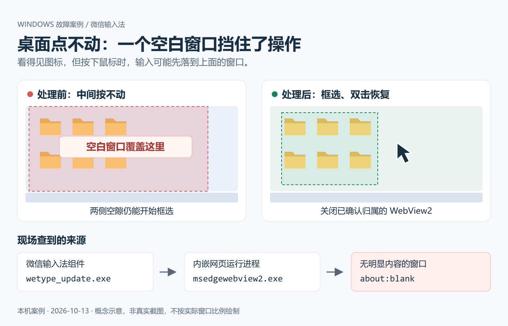
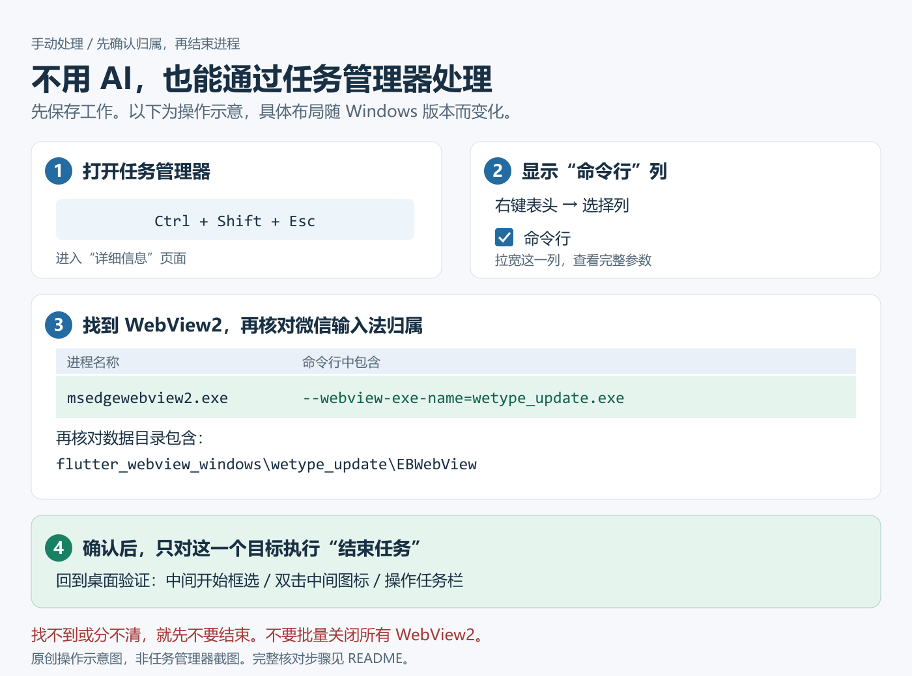

# 微信输入法导致桌面点不动，怎么解决

桌面中间点不动，只有左右边缘能开始框选？本案例定位到微信输入法启动的空白窗口，关闭对应进程后恢复。

**这是一个已验证的 Windows 本机案例和处理指南。**它记录了现场恢复方法；具体触发条件、其他版本是否受影响，以及是否会复发，仍未确认。



**先对照现象**

- 任务栏、其他应用正常，桌面中间区域却点不动。
- 从最左侧或最右侧开始拖动，可以框选图标。
- 从中间图标之间的空白位置按下鼠标，无法开始框选。

相同现象也可能由其他程序造成。先确认遮挡来源，不要只看见 `msedgewebview2.exe` 就结束它。

**不用 AI：手动处理**



1. **保存工作**，按 `Ctrl + Shift + Esc` 打开任务管理器。
2. 进入 **详细信息**，右键“名称、PID”等表头 → **选择列** → 勾选 **命令行**，拉宽这一列。
3. 在 `msedgewebview2.exe` 中寻找命令行包含以下内容的进程：

   ```text
   --webview-exe-name=wetype_update.exe
   ```

   再核对其数据目录包含 `flutter_webview_windows\wetype_update\EBWebView`。可找到父组件 `wetype_update.exe`，通过“打开文件所在的位置”核对它属于 `Tencent\WeType\` 安装目录。

4. **确认归属后，只选择这个 WebView2 根进程，右键“结束任务”。**微信输入法的相关网页界面可能随之关闭。本案结束后，输入法其他主进程仍在运行。
5. 返回桌面，测试 **中间开始框选、双击中间图标、操作任务栏**。三项都正常才算恢复。

**不要批量结束所有 WebView2，也不要卸载 WebView2。**其他应用也会使用它。找不到匹配参数、无法区分多个候选项或看不清完整命令行时，先不要猜着结束。任务管理器不同版本的布局可能略有差别。

如果急需恢复使用但无法定位，可以保存工作后重启电脑作为备用办法；本案没有用重启验证，不能保证不复发。

**这个窗口从哪来，为什么会挡住鼠标？**

现场查到的链路：

```text
wetype_service.exe          微信输入法服务
└─ wetype_update.exe        微信输入法组件
   └─ msedgewebview2.exe    内嵌网页运行进程
      └─ about:blank       覆盖桌面中部的空白窗口
```

WebView2 用来承载应用内的网页界面，可以由应用在后台启动，不要求用户打开浏览器。[微软 WebView2 进程模型](https://learn.microsoft.com/en-us/microsoft-edge/webview2/concepts/process-model)

这次现象像桌面前残留了一块“看不见的玻璃”。Windows 根据窗口位置、命中测试和鼠标捕获状态分发输入；没有明显画面内容，并不意味着该位置一定能操作下面的桌面。具体透明绘制方式、鼠标消息轨迹在本案中没有测定。[微软鼠标命中测试说明](https://learn.microsoft.com/en-us/windows/win32/inputdev/wm-nchittest)

`wetype_update.exe` 的名称不能证明当时正在安装更新，`about:blank` 也不能说明原本要显示什么页面。能确认窗口所属组件，具体异常触发原因需要厂商继续调查。

**本次验证了什么？**

| 项目 | 现场记录 |
| --- | --- |
| Windows | Windows 11 23H2，22631.6199，200% 缩放 |
| 微信输入法组件 | 3.0.0.17 |
| WebView2 | 147.0.3912.86 |
| 空白窗口 | `about:blank` / `Chrome_WidgetWin_1`，可见、启用 |
| 逻辑坐标 | 窗口 `(10,0)—(1090,800)`；屏幕 `1280×800` |
| 来源确认 | 父进程、命令行和数据目录均指向微信输入法组件 |
| 处理 | 仅停止核对过归属的 WebView2 根进程 |
| 用户复测 | “中间可以框选，双击也正常了” |

早期曾尝试处理动态壁纸和重启资源管理器，但中间区域异常仍在；不能据此把动态壁纸认定为根因。完整经过见 [排查报告](docs/case-report.md)。

**有 AI：让它先找证据，再做关闭测试**

复制这段描述给能够读取本机窗口、进程信息的 AI。只有聊天能力的 AI，需要你提供诊断结果，无法自行检查电脑。

> 我的 Windows 桌面只有左右边缘能开始框选，中间空白区域按鼠标没有反应，任务栏正常。请先只读检查是否有无明显内容的窗口覆盖桌面：记录窗口边界、状态、所属进程、父进程和命令行，并与失效区域对照。不要仅凭 WebView2 名称判断来源，不要一开始就重装系统、删除配置或批量结束进程。找到明确对象后，做一次最小范围的关闭测试，再让我从中间开始框选并双击验证。说明哪些是现场事实、哪些只是推测。

**完整记录与反馈**

- [完整排查报告、原理解释与可复制的厂商反馈摘要](docs/case-report.md)
- [问题讨论 / 提交自己的案例](https://github.com/touensan/wetype-desktop-fix/issues)
- 原创插图的可编辑文件：[遮挡原理 SVG](assets/desktop-overlay.svg)、[手动步骤 SVG](assets/manual-steps.svg)。均为示意图，不是真实界面截图。

反馈时请写明 Windows 和输入法版本、缩放比例、现象、结束哪个归属的进程后是否恢复。截图请遮住用户名、私人文件名和账号信息。本项目是用户整理的案例，不是微信输入法官方项目，也不是补丁或一键修复工具。

文档与原创插图按 [MIT License](LICENSE) 开放复用；外部链接内容遵循原作者许可。
